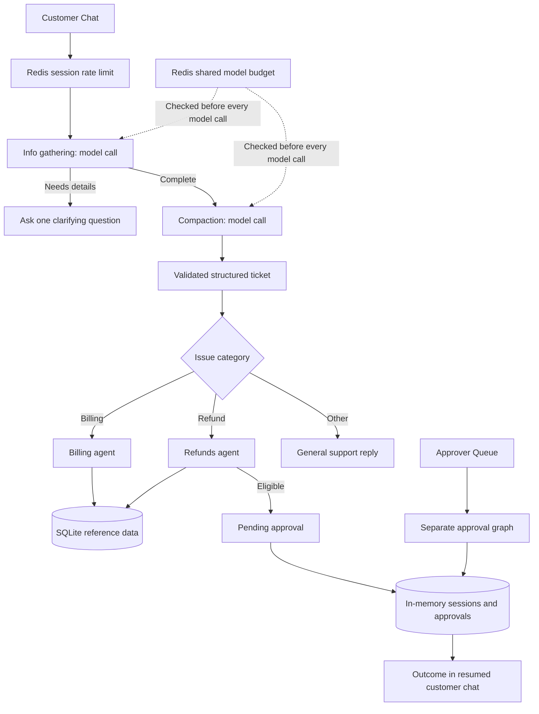
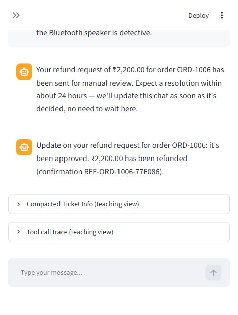

# Multi-Agent Customer Support

A conversational customer-support proof of concept built with **Streamlit**, **LangGraph**, **LiteLLM**, **SQLite**, and **Upstash Redis**.

The app gathers details over multiple turns, compacts the conversation into a validated ticket, and routes it to a billing or refunds specialist. Eligible refunds enter a separate human-review queue. The customer receives an immediate response and can resume the chat later to see the decision.

> This is a runnable learning project. Orders are seeded demo data, approvals produce simulated confirmation messages, and no money is transferred.

## What it demonstrates

- **Multi-turn information gathering:** ask for missing order details before routing.
- **Context compaction:** convert chat history into a small Pydantic ticket schema.
- **Specialist routing:** billing and refunds agents consume structured facts and use deterministic tools.
- **Database-backed tools:** invoice, payment, and eligibility lookups use read-only SQLite connections.
- **Asynchronous human review:** every eligible refund requires a human decision in a separate graph invocation.
- **Session resume:** return to a session ID to read its conversation and approval outcome while the server process is running.
- **Redis rate limiting:** atomic fixed-window limits per session and across all model calls.
- **Failure handling:** safe service errors, failed-turn rollback, positive refund-amount validation, and duplicate approval protection.

## Architecture



The customer graph always runs to completion. Pending approval is a stored record; it does not suspend an execution or use LangGraph `interrupt()`. The approval graph later appends a decision to the same session store.

Only information gathering and compaction call the model. Specialist agents use local tools and templated replies. Redis stores hashed identifiers and expiring counters, not chat history.

## Technology

| Component | Role |
|---|---|
| Python 3.11+ | Application runtime; verified locally with Python 3.14.6 on Windows |
| Streamlit | Customer Chat and Approver Queue interfaces |
| LangGraph | Customer-turn and human-decision orchestration |
| LiteLLM | JSON model completions; verified with `gpt-4o-mini` |
| Pydantic | Ticket and approval schemas |
| SQLite | Seeded order, invoice, payment, and eligibility reference data |
| Upstash Redis REST API | Atomic rate-limit admission using Lua `EVAL` |
| unittest + Streamlit AppTest | Workflow and rendered-UI regression tests |

## Quick start

You need Python, an API key for the configured model, and an Upstash Redis database with a REST endpoint and a token that can write counters.

### Windows / PowerShell

```powershell
git clone https://github.com/harshgavandit/multi-agent-customer-support.git
cd multi-agent-customer-support
python -m venv .venv
.\.venv\Scripts\python.exe -m pip install -r requirements.txt
Copy-Item .env.example .env
```

Edit `.env` locally to supply `OPENAI_API_KEY`, `UPSTASH_REDIS_REST_URL`, and `UPSTASH_REDIS_REST_TOKEN`. Then run:

```powershell
.\.venv\Scripts\python.exe -m db.init_db
.\.venv\Scripts\python.exe -m streamlit run streamlit_app.py --server.address 127.0.0.1
```

### macOS / Linux

```bash
git clone https://github.com/harshgavandit/multi-agent-customer-support.git
cd multi-agent-customer-support
python3 -m venv .venv
source .venv/bin/activate
python -m pip install -r requirements.txt
cp .env.example .env
```

Edit `.env` with your credentials, then run:

```bash
python -m db.init_db
python -m streamlit run streamlit_app.py --server.address 127.0.0.1
```

Open [http://127.0.0.1:8501](http://127.0.0.1:8501). Use the sidebar to switch views. On a narrow viewport, open the sidebar with the arrow before using session controls.

**Database initialization:** the script creates `data/support.db` with 12 example orders (`ORD-1001` through `ORD-1012`). Running it again drops and recreates the reference tables. The app also bootstraps a missing database automatically; the generated database is not committed.

Configuration loads `.env` from the project directory. Relative database paths resolve against that directory. Existing environment variables take precedence over `.env`.

## Configuration

| Variable | Default | Purpose |
|---|---|---|
| `OPENAI_API_KEY` | Required for OpenAI models | Model-provider credential; keep in `.env` |
| `LLM_MODEL` | `gpt-4o-mini` | LiteLLM model identifier |
| `DB_PATH` | `data/support.db` | SQLite reference database |
| `APPROVAL_TURNAROUND_HOURS` | `24` | Estimated review time shown in the demo reply |
| `LLM_TIMEOUT_SECONDS` | `30` | Timeout for each model request |
| `UPSTASH_REDIS_REST_URL` | Required with rate limiting | Upstash HTTPS REST endpoint |
| `UPSTASH_REDIS_REST_TOKEN` | Required with rate limiting | Redis token with write access |
| `RATE_LIMIT_ENABLED` | `true` | Enable Redis limits; `false` is an explicit local-development opt-out |
| `RATE_LIMIT_REQUESTS` | `10` | Customer turns per session per window |
| `RATE_LIMIT_WINDOW_SECONDS` | `60` | Fixed-window duration |
| `LLM_RATE_LIMIT_REQUESTS` | `60` | Model calls across all sessions per window |
| `RATE_LIMIT_PREFIX` | `customer-support` | Use a distinct namespace per application/environment |

A clarification turn uses one model call; a complete turn normally uses two. Creating a new session cannot bypass the shared model-call budget. Attempted calls consume admission even if the provider fails later. If Redis is unavailable, new requests are blocked with a safe error.

These are application request limits, separate from provider token and quota limits. Fixed windows can allow bursts across adjacent window boundaries. The implementation follows the [Upstash REST command format](https://upstash.com/docs/redis/features/restapi) and [server-side EVAL](https://upstash.com/docs/redis/sdks/ts/commands/scripts/eval).

Other LiteLLM-supported providers can be selected through `LLM_MODEL` and their own required environment variables. Live verification in this project covers the OpenAI configuration above.

## Try the workflows

| Scenario | Example message | Expected behavior |
|---|---|---|
| Clarification | `I have a problem with my order.` | Ask for more details |
| Billing | `Please check the invoice amount and payment status for ORD-1003.` | Show INR 5,600 invoice and pending payment |
| Eligible refund | `I want a refund of 2200 rupees for ORD-1006 because the speaker is defective.` | Create one pending approval and respond immediately |
| Ineligible refund | `I want a refund of 12000 rupees for ORD-1005.` | Explain the seeded final-sale restriction; do not queue an approval |
| Unknown order | `Please check the payment status for ORD-9999.` | Explain that the order was not found |
| General support | Describe a technical or account issue | Route to the general-support demo reply |

For the approval demo:

1. Submit an eligible refund and note the session ID.
2. Switch to **Approver Queue**, expand the request, and choose **Approve** or **Deny**.
3. Return to **Customer Chat** to see the outcome.
4. Choose **New Session** to verify an empty history.
5. Enter the original ID and choose **Resume** to restore the conversation.

No refund is automatically approved based on amount. Repeated pending requests for the same session/order do not create another record, and an already resolved approval cannot be resolved again.

See [conversation.md](conversation.md) for additional sample conversations.

## Tests and verification

Run the deterministic suite without real API credentials or Redis:

```bash
python -m unittest discover -s tests -v
python -m pip check
```

On Windows without activation, replace `python` with `.\.venv\Scripts\python.exe`.

Run real-service verification after configuring `.env`:

```bash
python -m scripts.verify_live
```

This makes small billable model requests and writes `verification/live_checks.json`. Redis probes use unique namespaces and expiring counters; the script does not flush Redis or reset reference data. CI runs only deterministic tests and does not require provider secrets.

Recorded local verification on **14 October 2026**:

- **33 automated tests passed:** graph routing, reference tools, session isolation, rollback, malformed model responses, invalid amounts, duplicate/concurrent approvals, Redis failures, and rendered UI controls.
- **11 real-service checks passed:** real JSON model completion, multi-turn billing, approval and denial, ineligible refunds, general support, Redis connectivity, concurrency, expiry, and application/model admission blocks.
- **Live browser verification passed:** refund submission, approval, empty new session, and restored approval outcome after Resume.

These are local evidence from the tested environment; they do not establish production readiness or guarantee future provider availability. Details are in [verification/VERIFICATION.md](verification/VERIFICATION.md) and [verification/live_checks.json](verification/live_checks.json).

<details>
<summary>Browser proof: simulated approval outcome after Resume</summary>



</details>

`requirements.txt` is the portable installation entry point. `requirements-lock.txt` records the exact packages from the verified Windows/Python 3.14 environment; platform-specific pins may need adjustment on other platforms.

## Project structure

```text
agents/                    Billing and refunds specialists
db/                       SQLite schema, seed data, and connection helpers
llm/                       Central model-completion wrapper
pipeline/                  State schemas and both LangGraph flows
session/                   Shared in-memory sessions and approvals
tools/                    Read-only reference-data tools
views/                     Streamlit customer and approver interfaces
scripts/verify_live.py      Real-service verification
tests/                    Workflow and rendered-UI tests
verification/              Retained local verification evidence
config.py                  Validated project-relative configuration
errors.py                  Safe application errors
rate_limit.py              Atomic Redis admission checks
streamlit_app.py           Application entry point
.env.example               Credential placeholders and settings
```

## Scope and limitations

- **Memory lifetime:** sessions, approvals, and their locks live in one server process. A restart loses this state; multiple processes do not share it.
- **No authentication:** the approver view is accessible to anyone who can access the app. Session IDs are demo cursors, not an access-control system. Keep the app local unless authentication and authorization are added.
- **Simulated refunds:** confirmation messages do not execute payments. Seeded eligibility flags are used rather than today's date or a live commerce policy.
- **General support is a demo:** the follow-up reply does not create a ticket in an external support platform.
- **No automatic provider fallback:** model errors are displayed safely so the customer can retry. Long conversations are still sent to the gathering/compaction model; compaction reduces downstream state, not the stored transcript.
- **No durable audit trail or PII redaction:** production use requires additional storage, identity controls, observability, and data handling.
- **Legacy design documentation:** [documentation.md](documentation.md) and `documentation.pdf` contain the original design narrative. This README and the verification report describe current operational behavior.

## Credential handling

Keep real credentials in the ignored `.env` file or your environment. `.env.example` contains placeholders only. Virtual environments, caches, temporary files, local logs, and the generated SQLite database are excluded from Git. Never paste real keys into source, issues, screenshots, or documentation.
