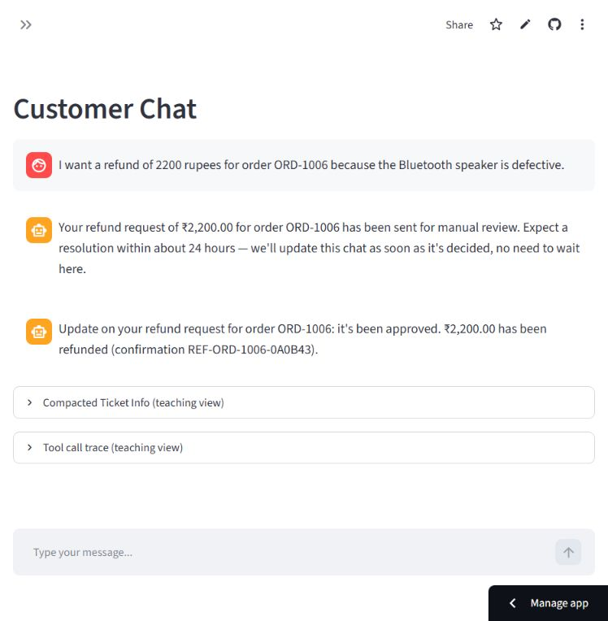
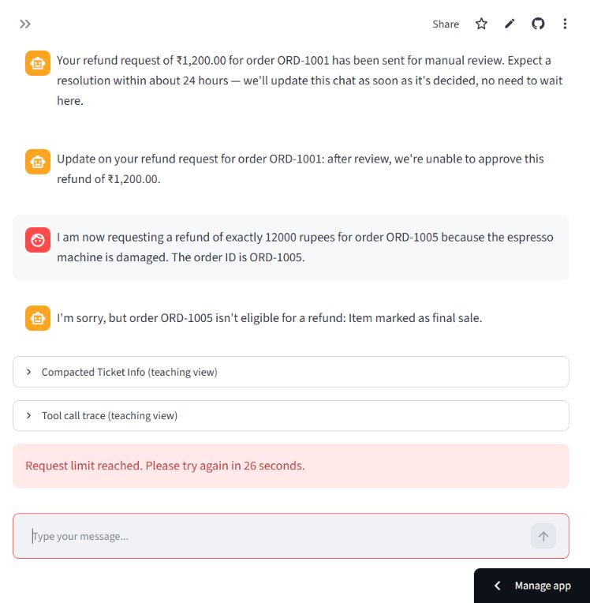

# Hosted verification

Verified on **20 October 2026** against [https://harsh-multi-agent-customer-support.streamlit.app/](https://harsh-multi-agent-customer-support.streamlit.app/).

## Deployment

- Streamlit Community Cloud, public GitHub repository `harshgavandit/multi-agent-customer-support`, branch `main`, main file `streamlit_app.py`.
- Application source: `1e03c1f3475368ee2ce1be0b0cf21c9c3c6274ef` (subsequent publication changes add documentation/evidence only).
- Observed cloud runtime: Python 3.14.8, Streamlit 1.66.0, LiteLLM 1.106.0.
- Root secrets configured through Advanced settings. Redis namespace: `customer-support-cloud`. Credentials are excluded from source and evidence.
- Cloud installation detected a pyarrow 26.0.0 compatibility issue and automatically replaced it with 24.0.0; the app started successfully.

## Results

**14 hosted checks passed, 0 failed.** All workflows below ran in the deployed browser UI with real model calls and Redis admission. Read-only counter checks and anonymous HTTP probes provided additional evidence.

| Check | Result | Observed evidence |
|---|---|---|
| hosted_startup | PASS | Streamlit Community Cloud built and started the app; Python 3.14.8 / Streamlit 1.66.0. |
| public_access | PASS | Anonymous requests.Session received HTTP 200 at the live URL with routing cookies only; no account credentials supplied. |
| server_health | PASS | GET /~/+/_stcore/health returned HTTP 200, text/plain body ok. |
| clarification | PASS | Vague order message produced a question asking for the issue and order ID. |
| billing | PASS | ORD-1003 returned INR 5600.00, Smartwatch, and pending payment. |
| refund_queued | PASS | ORD-1006 / INR 2200 produced one visible manual-review request. |
| human_approval | PASS | Approve cleared the queue and delivered a simulated confirmation to chat. |
| new_session_isolation | PASS | New Session displayed a different ID with empty message history. |
| resume | PASS | Resume restored the original ORD-1006 conversation and approval outcome. |
| human_denial | PASS | ORD-1001 / INR 1200 was queued after clarification, denied, removed from the queue, and delivered a refusal in chat. |
| ineligible_refund | PASS | ORD-1005 / INR 12000 was refused as final sale. |
| redis_cloud_counters | PASS | Read back this synthetic session and model counters in the customer-support-cloud namespace. |
| rate_limit_block_and_recovery | PASS | Primed only the synthetic test session counter to limit 10 with 30s TTL; hosted UI displayed try again in 26 seconds, then admitted a request after expiry. |
| general_support | PASS | After rate-limit expiry, a technical issue produced the deterministic general-support reply. |

The rate-limit test changed only the counter for this verification's synthetic
session, with automatic 30-second expiry. It did not change the shared model
budget or another session's counter. It verifies hosted denial and recovery;
it is not a high-load test. The earlier real-service verifier covers concurrent
atomic admission separately in `live_checks.json`.

The anonymous HTTP probe used a new requests.Session with no user credentials.
Streamlit's routing sets cookies and redirects the first request before serving
the app. The root-level `/_stcore/health` route serves the wrapper HTML; the
observed iframe prefix `/~/+/` routes to the real server health endpoint,
which returned `ok`.

## Browser evidence

Only synthetic order information appears in these screenshots. The confirmation
message is simulated; no payment provider is called and no funds move.

## Regression and publication checks

- Local deterministic workflow and rendered UI suite rerun on 20 October 2026: **33 tests passed**.
- Dependency consistency: **no broken requirements**.
- Secrets TOML parsed successfully and is ignored by Git.
- Public-source and documentation credential scan passed before publication.

## Practical limits

Sessions and approvals remain in one process's memory. Restarts or cloud sleep
lose them. The Approver Queue has no authentication/role gate, so this is a
public teaching demo using synthetic data. General support does not open an
external support ticket. The model asked an additional order-ID confirmation
when changing from ORD-1006 to ORD-1001 in one conversation; answering it
completed the tested request. No broad model-quality or production-readiness
claim is made.
